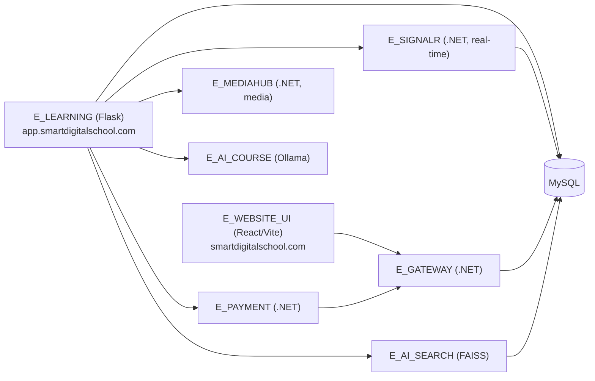

# Smart Digital School

[](LICENSE)
[](https://www.smartdigitalschool.com/)

[](https://eware.dev)

**Live site: <https://www.smartdigitalschool.com/>**

## About

**Smart Digital School** is a platform for creating and running digital schools and distance-learning programs. It lets schools and trainers manage their courses, instructors and students, and grow their activity from a single place, with a modern web experience.

Key capabilities, backed by the services in this repository:

- **Digital school management**: schools, instructors, students and courses.
- **Online payments and subscriptions** (PayPal, bank transfer details, invoices).
- **Media hub** for uploading, previewing and downloading course content.
- **Real-time features** through SignalR.
- **AI-assisted course generation** (Ollama) and **semantic search** (FAISS).
- **Transactional emails**, captcha and a dedicated API gateway.

Technically, it is a set of cooperating services: a Python/Flask core, .NET microservices (gateway, payment, media, real-time), AI services (course generation and semantic search) and a React front-end.

## Architecture



| Folder | Role | Stack |
|---|---|---|
| `E_LEARNING` | Core platform and API | Python, Flask |
| `E_GATEWAY` | Gateway, mail, captcha, subscriptions | ASP.NET Core |
| `E_PAYMENT` | Payment / subscription pages | ASP.NET Core |
| `E_MEDIAHUB` | Media upload, download and preview | ASP.NET Core |
| `E_SIGNALR` | Real-time communication | ASP.NET Core, SignalR |
| `E_AI_COURSE` | AI course generation | Python, Ollama |
| `E_AI_SEARCH` | Semantic search | Python, FAISS |
| `E_WEBSITE_UI` | Web front-end | React, Vite, TypeScript |
| `SmartDigitalSchoolApp` | Client application | .NET |

## Prerequisites

- Docker and Docker Compose (recommended)
- .NET SDK, Python 3.11+, Node.js 18+ (for running services without Docker)
- MySQL 8+

## Getting started

1. **Clone the repository**
   ```bash
   git clone https://github.com/mehdibaghdadi/smart-digital-school.git
   cd smart-digital-school
   ```
2. **Create your local configuration** from the provided templates. Real configuration files are git-ignored.

   | Copy | To |
   |---|---|
   | `E_LEARNING/.env.example` | `E_LEARNING/.env` |
   | `E_AI_SEARCH/.env.example` | `E_AI_SEARCH/.env` |
   | `E_AI_COURSE/.env.example` | `E_AI_COURSE/.env` |
   | `E_GATEWAY/appsettings.example.json` | `E_GATEWAY/appsettings.json` |
   | `E_PAYMENT/appsettings.example.json` | `E_PAYMENT/appsettings.json` |
   | `E_MEDIAHUB/appsettings.example.json` | `E_MEDIAHUB/appsettings.json` |
   | `E_SIGNALR/appsettings.example.json` | `E_SIGNALR/appsettings.json` |

   Replace every `CHANGE_ME` value.
3. **Start the stack**
   ```bash
   docker compose up --build
   ```
4. **Front-end only (development)**
   ```bash
   cd E_WEBSITE_UI
   npm install
   npm run dev
   ```

## Security

Never commit secrets (passwords, API keys, tokens). See [SECURITY.md](SECURITY.md).

## Contributing

Contributions are welcome. Please read [CONTRIBUTING.md](CONTRIBUTING.md) and our [Code of Conduct](CODE_OF_CONDUCT.md).

## License

Distributed under the MIT License. See [LICENSE](LICENSE).

## Author

Created and maintained by [eware.dev](https://eware.dev) - [contact@eware.dev](mailto:contact@eware.dev).
